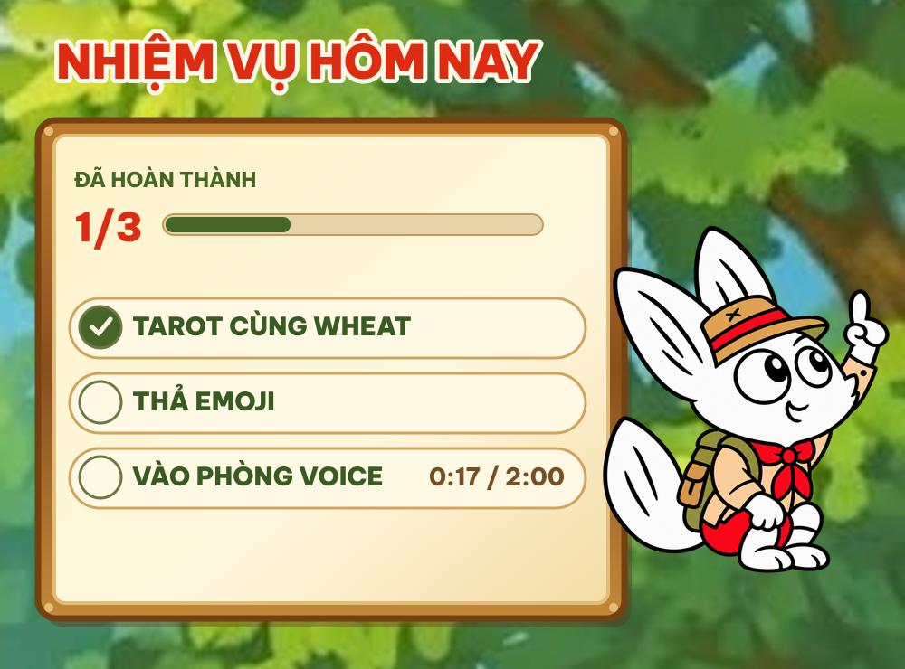
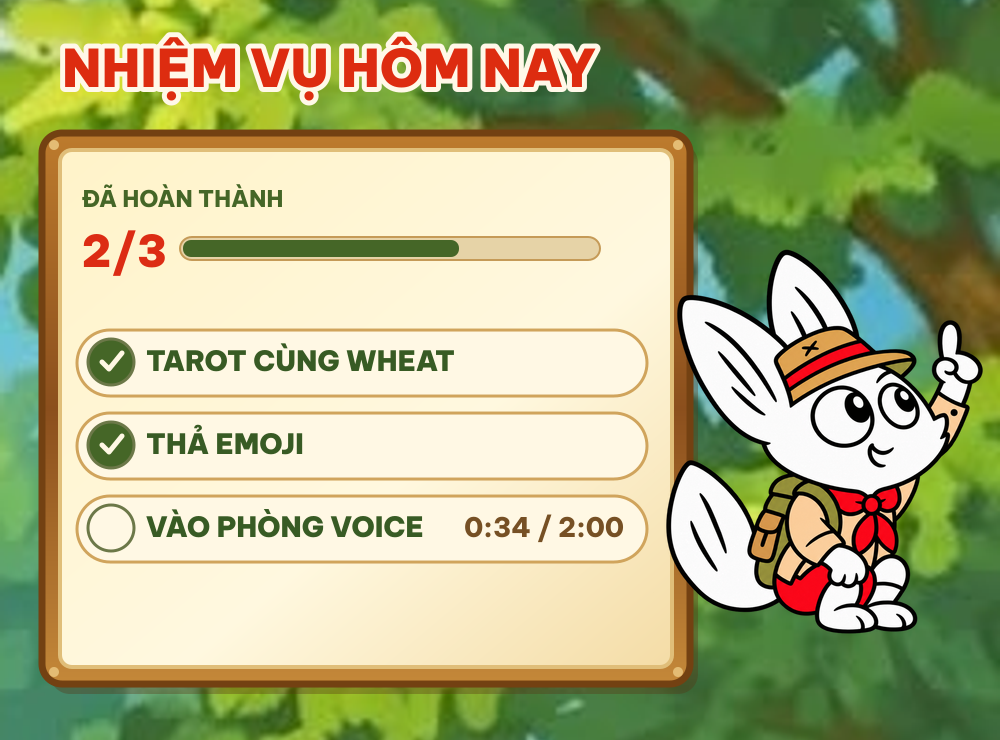
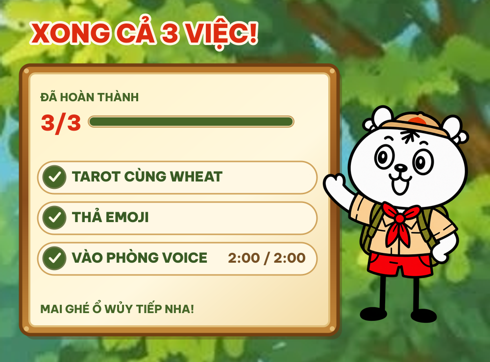

# Demo MarStreak trong 5 phút

Xem ảnh ngay trên GitHub, hoặc tải repo và double-click [`DEMO.html`](DEMO.html) để mở thư viện ảnh offline. Các ảnh dưới đây dùng dữ liệu mẫu.

1. **Điểm danh.** `/checkin` hiện chuỗi ngày và ba nhiệm vụ. `/quests` mở lại bảng cùng ngày.
2. **Làm một việc.** Mở đúng kênh trên thẻ. Nếu dùng bot ngoài, chọn đúng tên app trong menu slash. Nếu là Poll và đã bật, chọn đáp án rồi bấm **Vote**.
3. **Xem kết quả.** Bấm **Xem tiến độ mới** và xem DM nếu Discord cho phép.

| 0/3 | 1/3 |
| --- | --- |
|  |  |
| **2/3** | **3/3** |
|  |  |

[Ảnh DM báo tiến độ](quest-dm-preview.png) · [Chạy demo Discord bằng app của bạn](../../README.md#chạy-thử-trong-server-discord-riêng) · [Phiếu bàn giao cho Lead](../HANDOFF.md)
