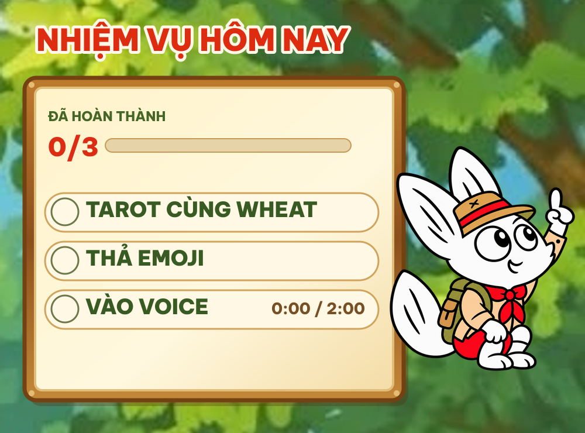

# Demo

`/checkin` mở thẻ điểm danh và giao ba nhiệm vụ. Mỗi dòng trên bảng cho biết cần làm gì và ở đâu. Với lệnh bot ngoài, chọn đúng tên ứng dụng trong menu Discord. Sau khi làm xong, bấm **Xem tiến độ mới** hoặc mở lại `/quests`.

| Vừa nhận nhiệm vụ | Hoàn thành một việc |
| --- | --- |
|  |  |
| **Còn một việc** | **Hoàn thành cả ba** |
|  |  |

Khi Discord cho phép nhận tin riêng, bot gửi cập nhật sau mỗi nhiệm vụ hoàn thành. [Ảnh tin nhắn riêng](quest-dm-preview.png)

Các ảnh minh họa dùng dữ liệu mẫu. Nhân vật tai dài và nhân vật đầu tròn tạm lấy từ poster “Người thầy có thể đến từ nhiều nơi”, có chỉnh lại nét nhân vật bằng AI. Nền rừng cắt từ poster “Điều ở lại không chỉ là kiến thức” (vùng 270 × 500 px tại x=810, y=0). Cả hai poster thuộc bộ tham chiếu Lab ngày 21/11. Nội dung, thanh tiến độ và biểu tượng hoàn thành được dựng bằng code. [Tài sản](../../assets/) · [Bộ dựng ảnh](../../src/quest-visual.js)

Sau khi tải repo, mở `docs/demo/DEMO.html` để xem ngoại tuyến. Khi xem trên GitHub, dùng bảng ảnh phía trên. [Trang HTML](DEMO.html) · [Chạy thử trên Discord](../../README.md#chạy-thử-trong-server-discord-riêng) · [Hồ sơ bàn giao](../HANDOFF.md)
